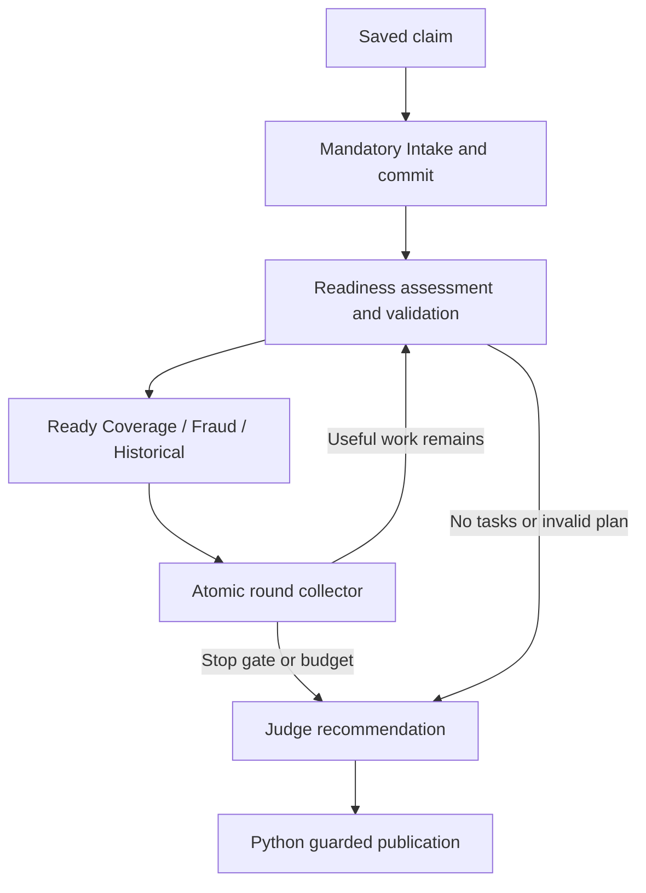

# How the claims workspace fits together

## Backend component map

| Architecture component | Where to start |
| --- | --- |
| React-to-FastAPI boundary and SSE | [`api/workspace_api.py`](../backend/api/workspace_api.py) |
| Accounts and staff investigation views | [`api/portal_routes.py`](../backend/api/portal_routes.py) |
| Policy document uploads and bindings | [`api/policy_document_routes.py`](../backend/api/policy_document_routes.py) |
| Synthetic claims and PDF selection | [`generation/synthetic_claim_generator.py`](../backend/generation/synthetic_claim_generator.py), [`workflow/selected_policy.py`](../backend/workflow/selected_policy.py) |
| Durable local jobs and checkpoints | [`workflow/investigation_worker.py`](../backend/workflow/investigation_worker.py), [`workflow/claims_workflow.py`](../backend/workflow/claims_workflow.py) |
| Intake barrier, specialist dispatch, collector and judge | [`workflow/intake_first_graph.py`](../backend/workflow/intake_first_graph.py), [`workflow/specialist_readiness.py`](../backend/workflow/specialist_readiness.py), [`workflow/specialist_context.py`](../backend/workflow/specialist_context.py) |
| Live Claude and offline specialist execution | [`workflow/investigation_execution.py`](../backend/workflow/investigation_execution.py), [`agents/claude_investigation.py`](../backend/agents/claude_investigation.py), [`agents/specialist_preflight.py`](../backend/agents/specialist_preflight.py) |
| Anthropic streaming and model settings | [`agents/anthropic_stream.py`](../backend/agents/anthropic_stream.py), [`model_settings.py`](../backend/model_settings.py) |
| Specialist logic | [Intake](../backend/agents/intake_specialist.py), [Coverage](../backend/agents/coverage_specialist.py), [Fraud](../backend/agents/fraud_specialist.py), [Historical](../backend/agents/historical_comparer.py) |
| Scoped LangChain tools and evidence | [`evidence/specialist_evidence_tools.py`](../backend/evidence/specialist_evidence_tools.py), [claim history](../backend/evidence/claim_history.py), [manual document extraction](../backend/evidence/uploaded_claim_documents.py), [policy wording RAG](../backend/evidence/policy_wording_index.py) |
| Routing rules, publication and reprocessing | [`workflow/routing_rules.py`](../backend/workflow/routing_rules.py), [`workflow/claims_workflow.py`](../backend/workflow/claims_workflow.py), [`workflow/investigation_retry.py`](../backend/workflow/investigation_retry.py) |
| SQLite store and shared types | [`storage/sqlite_store.py`](../backend/storage/sqlite_store.py), [`claim_schemas.py`](../backend/claim_schemas.py) |
| Audit, investigation, Langfuse and confusion matrix | [audit export](../backend/assurance/claim_audit_export.py), [source provenance](../backend/assurance/execution_manifest.py), [investigation display](../backend/assurance/investigation_display.py), [Langfuse adapter](../backend/assurance/investigation_tracing.py), [evaluation](../backend/assurance/routing_evaluation.py) |

To follow one submitted claim, start at the relevant API or generator, then read
the worker, graph and specialist code. The host publishes the final route and
the assurance package exposes the stored evidence behind it.

There are five logical agents: the orchestrator, Intake, Coverage, Historical Comparer and Fraud. The same Fraud specialist can run twice, with different instructions and tool access.

## Versioned Intake-first graph

`backend/workflow/claims_workflow.py` chooses the graph by the assessment's
recorded version. Both v3 and the selected-PDF v4 pilot use the same LangGraph
builder and collector. The v4 graph adds a verification node between specialist
execution and collection. Each version has its own checkpoint namespace.

Intake must finish and commit before readiness. Claude assesses Coverage, Fraud
and Historical separately with evidence references and precise owned gaps. Python
validates the selection. Ready specialists run concurrently against one committed
snapshot; an atomic collector saves their findings and advances context once.
Historical requires committed COVERED coverage. Historical leads can trigger one
Fraud follow-up. Coverage failure, fraud, errors and exhausted budgets stop dispatch.
The judge recommends a route, then Python recomputes mandatory routing controls.

Specialists retrieve their own records through scoped LangChain tools. Python runs
`execute_checks` to gather evidence and validate required values and the policy
date range. It records exact duplicate and verified fraud signals before the
model call so a provider failure cannot erase them. Claude receives the audited
checks and structured submission, and can retrieve additional evidence.

Intake returns the model's narrative classification. Coverage returns its
interpretation of the applicable policy wording and any evidence conflicts.
Historical returns a judgment about comparable costs, plus scoped cost-document reuse
leads for independent verification. Fraud interprets verified evidence, records
alternative explanations and raises additional concerns for adjuster review.
Python retains exact policy, identity, arithmetic and publication controls.
Only retrieved evidence can be cited. Limits are four dispatch rounds after Intake, four standard turns per specialist
invocation, 40 model requests per claim and 15 minutes checked at dispatch and publication. A specialist may repair an invalid
submission once on the same turn. Coverage can also retry one truncated response with a larger output budget.

Python's scoped check tools and Claude's model-facing tools are separate. Every
specialist except Coverage can optionally `read_submission`. Coverage receives the
structured submission with its mandatory checks. Manual claims additionally expose
`read_uploaded_documents`. Coverage can `search_policy_documents` for bound synthetic wording or manual uploads. All roles
can `submit_analysis`. Context reads, duplicate searches, structured-policy reads,
comparable searches and verification operations are not callable by Claude.

Coverage can retry a timed-out model request once within its existing turn and
deadline limits. Each attempt is recorded separately and the retry uses the same
evidence. A persistent timeout records an unresolved finding for human review.

The `required_checks.supporting_evidence` list carries the exact structured-policy,
comparable or verification responses already retrieved by that role's Python
checks. Intake's list is empty because duplicate matches are retained in its
finding. The structured submission is supplied separately. Extracted upload text
is retrieved on demand.
The enclosing `required_checks.evidence_ref` cites both the check finding and its
supporting responses. A per-invocation callback observes copied retrieval results
only after their raw audit records commit. The aggregate envelope is frozen and
saved before the model request; raw evidence is not copied into downstream context.

Prior source references are also citable when they appear in the specialist's
filtered context and resolve to intact audit responses for the same assessment.
Hidden-role, invented and other-claim references remain forbidden. The validation
does not add a model request or make additional retrieval tools available.

Historical reuse checks match the printed `document_reference` on a manual
cost document and retain the attachment `document_id` separately. Synthetic
cost documents use their generated ID when they have no explicit reference.

Historical-lead verification retains its `verified` list and additionally records
`criteria` and per-lead `checks`: exact scoped records reread at verification time,
requested IDs, missing/out-of-scope IDs, matching distinct incidents and the result.
Another claim's record contents are never returned. These snapshots persist in
both raw audit responses and the mandatory-check envelope, enabling reconstruction
even when historical records subsequently change. These are additive JSON fields;
no database migration is required.

The same restricted mapping controls advertised tool definitions and execution.
Requesting a removed or cross-role tool fails the investigation through existing
human-review handling. Claim/upload reads remain available for details beyond
the initial findings, such as narrative, cost document details and extraction gaps.

`backend/workflow/investigation_execution.py` selects a live Claude or offline adapter using the
persisted assessment mode. Both use the same graph, collector, readiness validator,
publication guard and audit. Offline checks use provisional structured fixture
terms and refer claims with linked wording for review. Where policy wording is used, live
auto-approval requires cited applicable policy passages. A missing API
key does not change a stored model investigation into offline execution.

The sequential graph, v2 supervisor graph and additive model investigation loop
have been removed. Completed historical decisions and audits remain readable.
Unfinished unsupported versions cannot resume or retry under different rules.
Queued legacy manual submissions continue on v3. Staff retain access to old
attachments, audits and investigation decisions. New manual investigations and revisions
are closed.

Attachments on queued legacy manual assessments are prepared before Intake. Cached extraction and derived document facts
remain separate from the frozen submission. Historical staff decisions remain readable in audit exports.
The local audit stores a nested investigation trace, model request references and
context transitions. With export enabled, Langfuse receives trace hierarchies,
operational summaries and provider token usage for investigations, synthetic claim
previews, policy schedule generation and policy indexing. It can also receive text
and structured payloads when `CLAIMS_LANGFUSE_CAPTURE_PAYLOADS=1`. The SQLite audit
retains investigation evidence and model payloads.

See [Intake-first workflow](INTAKE_FIRST.md) and [debugging guide](DEBUGGING.md).

## Policy RAG

Administrators upload policy PDFs up to 12 MiB. Indexing is a persisted job processed by the local worker. PDFium reads embedded text and the local OCR engine reads scanned pages. Legacy manual assessments use their frozen uploaded-document snapshot. Staff select an indexed PDF for each new synthetic assessment.

The OpenAI Embeddings API embeds extracted policy passages and queries with `text-embedding-3-small`. The `sqlite-vec` virtual table stores vectors partitioned by document ID. SQLite scores passages by cosine similarity plus the keyword boost for topic searches. The top ten candidates, taken across the frozen document scope, are reranked locally with the pinned `ms-marco-MiniLM-L6-v2` cross-encoder against the original query. The tool returns up to five and records its reranking status. A reranker failure returns the top five by the first-stage score.

Chunks preserve exact page text and OCR provenance using 200 GPT-2 tokens and 40 tokens of overlap. Reindexing creates a new passage ID namespace, replaces the document's searchable vectors atomically and retains earlier passage rows for audit verification. Coverage can search the selected PDF by topic and retrieve a specific page to clarify tables or cross-references. For manual claims, retrieval searches the uploaded document snapshot and includes each result's document metadata.

In legacy manual claims, missing, unindexed or inapplicable wording leaves coverage unresolved and requires staff review. Completed assessments preserve their original sources for auditing.

## Three different SQLite databases

| File | Responsibility | Who accesses it |
| --- | --- | --- |
| `claims.sqlite3` | Submissions, policies, history, findings, context versions, tool calls, decisions, human tasks and events | Scoped tools, workflow, API |
| `checkpoints.sqlite3` | LangGraph execution state and resume checkpoints | Workflow runtime |
| `labels.sqlite3` | Generated scenarios, conditions, expected routes and batch identity | Generator and evaluator only |

Claude generates independent synthetic claims with fictional policy numbers. Commit creates an `awaiting_policy` assessment and stores ground truth in the separate labels database. Staff select an indexed PDF to queue the assessment. The queue transaction records the PDF ID, version and file hash, while the original claim retains its fictional policy number and submission hash.

Coverage retrieves passages only from the selected PDF and cites wording for supported conclusions and explicit evidence requirements. Product summaries support preliminary assessment. An adjuster verifies OCR-derived restrictions or document requests, the individual schedule and any payable amount. Audit exports include the original claim, selected PDF and retrieved passages. Archived assessments can still use their saved schedules and linked wording.

The local worker resumes queued/processing assessments and document indexing jobs at startup. It uses one graph connection in one process. Specialist findings are unique by assessment and round-qualified stage; collected rounds and retries reuse committed findings. Checkpoint thread IDs use `intake-first:<assessment_id>`; retired checkpoint data is never executed. Decision publication recomputes the expected route from stored findings and creates a human task in the same transaction.

Workflow events are the local durable event stream. They are not a completed external queue-delivery outbox. A pending task establishes local enqueueing; authenticated production delivery and acknowledgement still require implementation.

## Financial and routing rules

Rules are provisional fixtures awaiting the client's manual and authority definitions. More than LKR 250,000 gross always goes to a human, even when the deductible reduces payable below that amount. Exactly LKR 250,000 passes the monetary gate only.

Verified fraud indicators and high-severity Fraud findings with valid citations take precedence. The publication guard requests information when executed Intake or Coverage checks confirm that missing claimant evidence blocks a required assessment. Optional supporting evidence can be recorded for staff. This route creates an adjuster task for a gross claim above LKR 250,000. Otherwise duplicates, technical failures, coverage failures, valuation concerns and unresolved mandatory checks require review. Auto-approval is a provisional synthetic triage outcome. A routing correction to a published claim retains the original decision and records the transfer to the fraud queue.

The workflow checks for eligible history after coverage is confirmed. The Historical specialist's `retrieve_comparable_claims` tool gathers narratives, cost documents, published triage decisions and available staff decisions from distinct prior submissions in the same loss type and currency. The prior assessment must be complete with a triage decision published before the current submission. Claude selects genuinely similar incidents, explains how their outcomes inform the current assessment, and checks additional charges. Python audits the selected IDs and calculates statistics from any usable reconciled itemised cost totals. With no eligible history, Historical is skipped. Offline checks require exact narrative and item-description matches and apply the provisional twice-median rule. Any additional charge needs human review in offline mode.

## Audit and evaluation

The audit download captures the original submission, original bound wording, exact tool responses and passages, model requests/responses and token usage, context snapshots, findings, instructions, rule version, dependency versions, backend source and human actions. `verify_audit` checks package consistency. Local hashes are not signatures and cannot protect against a person rewriting every hash. Six-month immutable retention is not operationally enforced here.

The evaluator joins separate scenario labels with published predictions and emits an expected-row/predicted-column matrix. Pending predictions are explicitly counted and the report is marked partial. Labels never enter specialist tools or assessment context. The LLM labels assume no comparison history, and predictions can differ as eligible prior claims accumulate.

## Production steps after this slice

- Add scanned PDF/photo OCR and regional masking; text-based policy PDF extraction is implemented.
- Replace provisional document, fraud and authority rules with client-approved configuration.
- Move to PostgreSQL migrations, durable object storage and distributed worker leases.
- Add authenticated reviewers, external delivery receipts and SLA escalation.
- Add hard tool cancellation for in-flight operations. The workflow checks the deadline before model and tool dispatch and at publication.
- Meter OCR/model/hosting usage and source every unit price; no cost claim is fabricated.
- Validate the 3,000-claim surge, region restrictions and retained-audit restoration.

The frontend's information architecture follows the agreed dashboard: Overview, Claims, Human Review, Generator, Agent Activity, Evaluation, Audit and Settings. Events trigger data refreshes using SSE, with polling as a fallback.

## Context input audit (17 November 2026)

Context is useful where it carries a real dependency: Intake document gaps affect Coverage's information request and supported payable; historical cost-document reuse leads drive Fraud follow-up; the supervisor needs prior findings to select its next round; the judge and publication guard need the combined findings. These dependencies remain.

Specialists receive role-scoped views through `backend/workflow/specialist_context.py`. Coverage receives Intake and the policy retrieval result. For manual claims it also receives frozen policy-document references. Historical receives Intake and Coverage for model investigation. Initial Fraud receives Intake. Fraud follow-up receives Intake, Coverage, Historical and the earlier fraud finding. Intake's initial model message has no context field. Plans, recommendations, attachment-extraction blobs and unrelated findings are excluded from specialist views.

The deterministic Historical check computes from submission and retrieved settlements, so its previous context-version-only read was removed. Deterministic Fraud computes from verification tool results, so its unused context and submission reads were removed. Evidence references that implied those unused findings were consumed were also removed. Version tracking remains in the workflow and audit records.

Historical-lead verification now reads the supplied frozen round snapshot when present, matching the specialist's other inputs instead of accidentally consulting newer live context. The complete stored context and before/after audit snapshots remain intact; there is no database migration or deletion of historical evidence.

`tests/test_context.py` checks that useful inputs change results, irrelevant context is excluded, unused reads are unnecessary, and model task payloads retain only the intended dependencies. The full offline regression suite verifies routing and model workflows with mocked providers. No claim of improved model accuracy or measured token savings is made without a live comparative evaluation.
