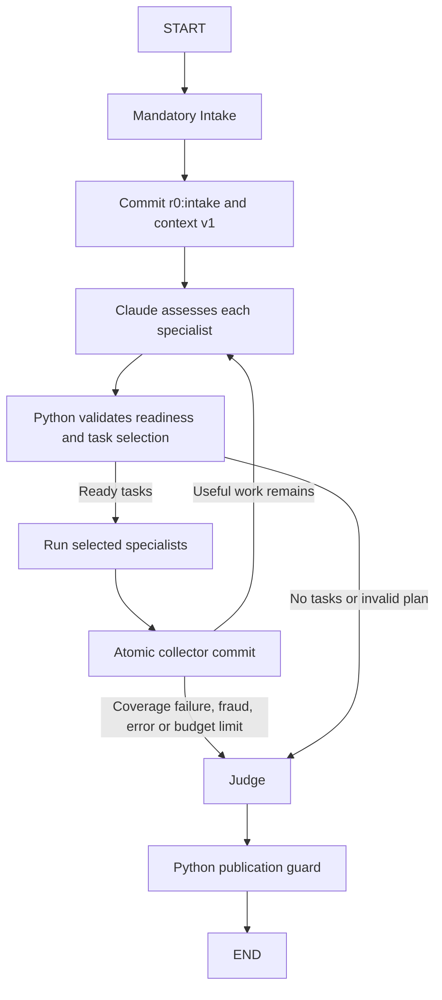

# Intake-first v3: implemented workflow

All new generated and manual assessments are stamped `claude-intake-first-v3`.
This is the only executable graph. Checkpoints use the `intake-first:` prefix.
Live Claude and offline adapters share this graph; the stored assessment mode
selects the adapter. Completed historical decisions remain readable. Unfinished
retired assessments must receive an explicit new investigation revision (manual)
or be regenerated (synthetic); their old checkpoints are never reinterpreted.



## Concrete code responsibilities

- `backend/workflow/intake_first_graph.py` owns the sole graph, Intake barrier, specialist
  execution, atomic collection and judging.
- `backend/workflow/investigation_execution.py` selects live/offline adapters on that same graph.
- `backend/workflow/claims_workflow.py` hosts checkpoints and guarded publication.
- `backend/workflow/specialist_readiness.py` defines the typed readiness response and dispatch validator.
- `backend/workflow/routing_rules.py` enforces
  human authority independently of Claude's readiness assessment and judge.

Every readiness response describes Coverage, Fraud and Historical as READY,
BLOCKED_INPUT, BLOCKED_DEPENDENCY, COMPLETED or NOT_APPLICABLE. It includes reasons,
exact evidence references, owned information gaps and a DISPATCH,
REQUEST_INFORMATION, REVIEW or FINISH action. The tasks must match READY states
exactly. Intake cannot be selected again.

Python rejects Historical dispatch before a committed COVERED finding, invented
citations, repeated checks without new fraud leads, unsupported completion claims
and claimant requirements absent from executed findings. Policy records and claim
documents are retrieved by specialists through existing scoped tools.

Coverage can run independently of Fraud. Fraud can run while the
loss date blocks Coverage. Internal service gaps require review; claimant gaps
can produce a precise information request if mandatory human gates do not apply.
Existing manual-claim routing still requires staff adjudication.

## Mandatory checks before model analysis

For each selected role, Python calls `execute_checks` directly before its first
Claude request. The result is audited as an `execute_checks` record and supplied
as `required_checks` with a citation reference in the initial model message.
The Python preflight checks required fields and dates. Claude interprets the
narrative, reconciles evidence and returns structured role-specific conclusions.
Manual Coverage needs cited, applicable uploaded wording. Generated Coverage
cites the linked generated policy. Policy and arithmetic controls validate the
model conclusion before publication. Historical supplies
potential matches for independent fraud verification. If analysis fails, the
collector preserves the audited preflight result, including verified fraud, and
applies the existing human gates.

Claude's retrieval tools are limited to `read_submission`, manual-only
`read_uploaded_documents`, and `search_policy_documents` for manual Coverage. Python
keeps its existing role-scoped check tools. Exact policy, comparable and verification
responses appear in `required_checks.supporting_evidence`, covered by the enclosing
audit citation. Intake's duplicate matches already appear in its check finding.
The callback captures each invocation separately; audit envelopes retain raw
supporting evidence without expanding accumulated findings or context.

## Persistence and stopping

Intake has a stable `r0:intake` run. The initial finding and enriched context are
saved together; readiness does not run until that commit. Parallel specialists
read one committed snapshot. Each collection advances the version once. Readiness
plans, rejected selections and gaps remain in `Assessment.context`; model calls
remain in the existing invocation audit. No schema migration is required.

Inactive/uncovered/unresolved coverage stops Historical work and records why.
Fraud indicators immediately proceed to guarded escalation after the round is
collected. Maximum work is four dispatch rounds after Intake, within the existing
40-model-request and 15-minute budgets. Exhaustion with pending work requires review.
Coverage and Historical cannot rerun in the same revision; Fraud can rerun once
when new historical leads exist. New claimant evidence requires a new revision.

Admins and staff see readiness history alongside investigation plans: the chosen
specialists, blocked inputs, dependencies and gaps. The workflow timeline labels
Intake as mandatory. Claimants do not receive internal investigation details.

## Verify without external calls

```powershell
$env:CLAIMS_LLM_MODE='deterministic'
.\.venv\Scripts\python.exe -m unittest discover -s tests -v
.\.venv\Scripts\python.exe scripts/debug_workflow.py --scenario historical-fraud
```

The debug command runs the v3 graph with scripted model responses and the saved
fixture policy. This exercises the
real graph, tool execution, database writes, guards and audit export. There is no
workflow-selection flag or retired execution path.

Restart the backend after deploying source changes. Unsupported unfinished
assessments fail with an explicit revision-required message; all new assessments
use the Intake-first graph. A live-Claude acceptance run and production validation remain separate
from the offline contract/regression tests.
