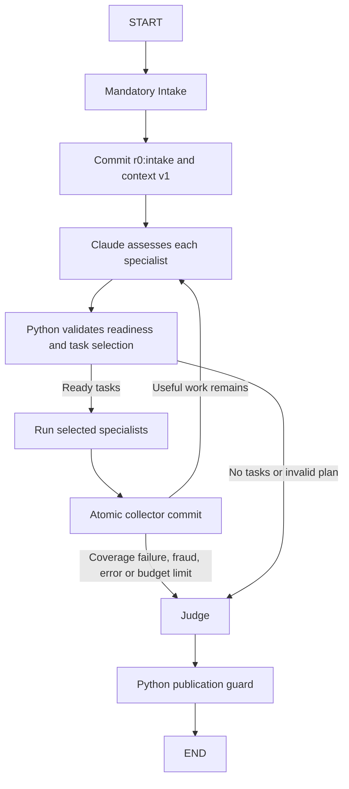

# Intake-first v3: implemented workflow

v3 is the default for newly queued selected-PDF assessments and for legacy
manual work already in the queue. v4 is opt-in and uses a separate checkpoint
namespace. Older decisions remain readable. New submissions are staff-generated
synthetic claims processed against a selected policy PDF.



## Concrete code responsibilities

- `backend/workflow/intake_first_graph.py` builds both versions and owns the Intake barrier, specialist
  execution, atomic collection and judging.
- `backend/workflow/investigation_execution.py` selects live/offline adapters on that same graph.
- `backend/workflow/claims_workflow.py` hosts checkpoints and guarded publication.
- `backend/workflow/specialist_readiness.py` defines the typed readiness response and dispatch validator.
- `backend/workflow/routing_rules.py` enforces
  human authority independently of Claude's readiness assessment and judge.

Every readiness response describes Coverage, Fraud and Historical as READY,
BLOCKED_INPUT, BLOCKED_DEPENDENCY, COMPLETED or NOT_APPLICABLE. It includes reasons,
exact evidence references, owned information gaps and a DISPATCH,
REQUEST_INFORMATION, REVIEW or FINISH action. The tasks must match READY states
exactly. Intake cannot be selected again.

Python requires a committed Historical comparison before Coverage runs when eligible
prior claims exist. It rejects invented citations, repeated checks without new fraud leads, unsupported completion claims
and claimant requirements absent from executed findings. Policy records and claim
documents are retrieved by specialists through existing scoped tools.

Coverage can run independently of Fraud. Fraud can run while the
loss date blocks Coverage. Internal service gaps require review; claimant gaps
can produce a precise information request if mandatory human gates do not apply.
Existing manual claims with unresolved findings route to adjuster review.

## Mandatory checks before model analysis

For each selected role, Python calls `execute_checks` directly before its first
Claude request. The result is audited as an `execute_checks` record and supplied
as `required_checks` with a citation reference in the initial model message.
The Python preflight checks required fields and dates. Claude interprets the
narrative, reconciles evidence and returns structured role-specific conclusions.
Manual Coverage needs cited, applicable uploaded wording. For new synthetic claims, Coverage
cites the uploaded PDF version selected by staff. Policy and arithmetic controls validate the
model conclusion before publication. Coverage records a reason for its confirmed,
partially confirmed or unconfirmed outcome. Historical supplies similar-case decisions
for Coverage and potential matches for independent fraud verification. If analysis fails, the
collector preserves the audited preflight result, including verified fraud, and
applies the existing human gates.

Claude's retrieval tools include `read_submission`, manual-only
`read_uploaded_documents`, and scoped `search_policy_documents` for Coverage. For a selected PDF,
Coverage can also use `read_policy_page`. The Fraud analysis for a selected PDF receives the frozen claim
evidence and Python's historical checks without policy retrieval. Python
keeps its existing role-scoped check tools. Exact policy, comparable and verification
responses appear in `required_checks.supporting_evidence`, covered by the enclosing
audit citation. Intake's duplicate matches already appear in its check finding.
The callback captures each invocation separately; audit envelopes retain raw
supporting evidence without expanding accumulated findings or context.

## Persistence and stopping

Intake has a stable `r0:intake` run. The initial finding and enriched context are
saved together; readiness does not run until that commit. Parallel specialists
read one committed snapshot. Each collection advances the version once. Readiness
plans, rejected selections and gaps remain in `Assessment.context`; model calls
remain in the existing invocation audit. No schema migration is required.

Historical can run after Intake regardless of the eventual Coverage outcome.
Fraud indicators immediately proceed to guarded escalation after the round is
collected. Maximum work is four dispatch rounds after Intake, within the existing
40-model-request and 15-minute budgets. Exhaustion with pending work requires review.
Coverage and Historical cannot rerun in the same revision; Fraud can rerun once
when new historical leads exist. New claimant evidence requires a new revision.

Admins and staff see readiness history alongside investigation plans: the chosen
specialists, blocked inputs, dependencies and gaps. The workflow timeline labels
Intake as mandatory. Claimants do not receive internal investigation details.

## Verify without external calls

```powershell
$env:CLAIMS_LLM_MODE='deterministic'
.\.venv\Scripts\python.exe -m unittest discover -s tests -v
.\.venv\Scripts\python.exe scripts/debug_workflow.py --scenario historical-fraud
```

The debug command runs the v3 graph with scripted model responses and the saved
fixture policy. This exercises the
real graph, tool execution, database writes, guards and audit export. Set `CLAIMS_SELECTED_PDF_WORKFLOW=v4` to exercise the v4 pilot for newly selected PDFs.

Restart the backend after deploying source changes. Unsupported unfinished versions cannot resume. Queued supported versions retain their recorded graph. A live-Claude acceptance run and production validation remain separate
from the offline contract/regression tests.
